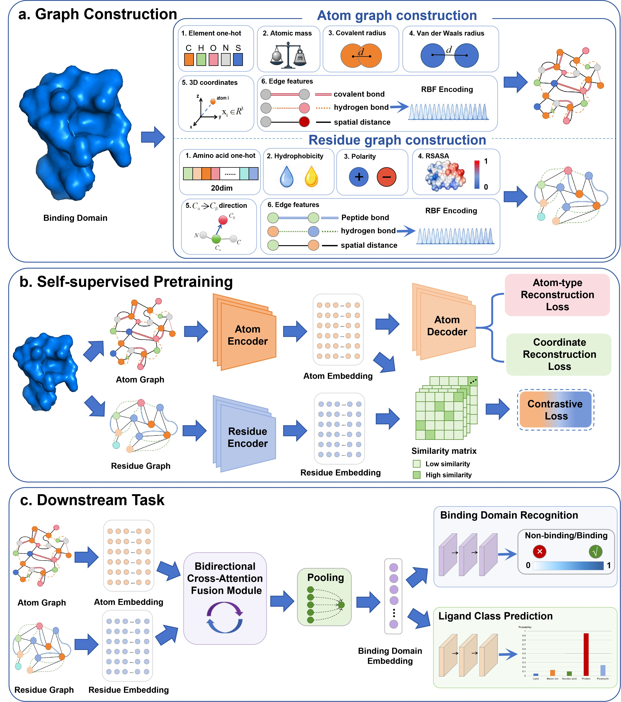

# ARBindNet

ARBindNet is a geometric deep-learning workflow for learning protein binding-domain representations from three-dimensional structures. It jointly models proteins at two resolutions:

- an atom-level graph encoded with an E(n)-equivariant graph neural network (EGNN); and
- a residue-level graph encoded with a geometric vector perceptron (GVP) network.

The two representations are aligned and fused for self-supervised pretraining and downstream tasks, including binding-domain recognition and ligand-category classification.



## Highlights

- PDB structure download and binding-site sample generation
- Atom- and residue-level graph construction
- Multi-scale geometric representation learning with EGNN and GVP encoders
- Cross-level atom-to-residue fusion
- Self-supervised pretraining with cross-level contrastive learning and masked atom reconstruction
- Binary binding-domain recognition
- Ligand-category multiclass classification
- Pretrained checkpoints and normalization statistics

## Repository structure

```text
ARBindNet/
├── data_download/          # PDB ID list and RCSB PDB download script
├── data_sample/            # Binding-domain sampling and preprocessing utilities
│   ├── IEProtLib/          # Molecular and geometric data-processing utilities
│   └── sample_pipeline/    # PDB-to-domain/HDF5 preprocessing pipeline
├── graph_construction/     # Atom/residue graph construction and data splits
├── pretrain/               # Self-supervised ARBindNet pretraining
├── domain_recognition/     # Binary binding-domain classification
├── ligand_multiclass/      # Ligand-category multiclass classification
├── weights/                # Released checkpoints and normalization statistics
├── Figure/                 # Model architecture figure
└── environment.yml         # Conda environment specification
```

## Model overview

ARBindNet represents each protein domain with two coupled graphs:

1. **Atom graph.** Atomic features, coordinates, and pairwise edge features are encoded by an EGNN.
2. **Residue graph.** Residue scalar/vector features and geometric edge features are encoded by a GVP network.
3. **Cross-level fusion.** Atom embeddings are pooled to their parent residues and fused with residue embeddings.
4. **Self-supervised objectives.** Pretraining combines a symmetric atom/residue contrastive objective with masked atom-type and coordinate reconstruction.
5. **Downstream prediction.** The pretrained encoders are fine-tuned for binary domain recognition or ligand-category classification.

## Requirements

The provided environment targets Linux with Python 3.10, PyTorch 2.0.1, CUDA 11.8, DGL 2.1, and common structural-bioinformatics packages. A CUDA-capable GPU is recommended for training.

Major dependencies include:

- Python 3.10
- PyTorch 2.0.1 with CUDA 11.8
- DGL 2.1 with CUDA 11.8
- torch-scatter
- Biopython and Biopandas
- RDKit
- h5py
- NumPy, SciPy, pandas, and scikit-learn
- MSMS for molecular-surface calculations during sample generation

Create the environment with:

```bash
git clone https://github.com/NENUBioCompute/ARBindNet.git
cd ARBindNet
conda env create -f environment.yml
conda activate tyt_ae
```

The exported environment contains CUDA-specific packages. Adjust the PyTorch, DGL, and CUDA builds if your system uses a different CUDA version or CPU-only execution.

## Important path configuration

Several scripts currently contain absolute paths from the original compute server. Before running the full workflow on another system, locate and replace them:

```bash
grep -R "/datapool/" -n \
  data_sample graph_construction pretrain domain_recognition ligand_multiclass
```

In particular, review:

- the default output directory in `data_sample/sample_pipeline/data_preprocessing.py`;
- PDB/HDF5 paths and the input list in `graph_construction/create_graph.py`;
- the normalization-statistics path in `pretrain/train_PRE.py`;
- the normalization-statistics paths in `domain_recognition/finetune.py`; and
- the working directories and data paths in the provided SLURM scripts.

## Workflow

### 1. Download PDB structures

`data_download/pdb_list.txt` contains the PDB identifiers. The download script retrieves corresponding structures from RCSB PDB and writes them to `data_download/TMPDB/`.

```bash
cd data_download
python download.py
cd ..
```

### 2. Generate binding-domain samples

The preprocessing pipeline accepts either one PDB file or a directory of PDB files:

```bash
cd data_sample/sample_pipeline
python data_preprocessing.py --pdbpath ../../data_download/TMPDB
cd ../..
```

Before running this command, configure the output directory (`w_dir`) in `data_preprocessing.py` and ensure that the `msms` executable is available on `PATH`.

The pipeline identifies positive and negative domains, writes domain-level PDB files, records ligand information, and generates HDF5 molecular representations.

### 3. Construct atom and residue graphs

Edit the input list, PDB directories, and output directory near the bottom of `graph_construction/create_graph.py`, then run:

```bash
cd graph_construction
python create_graph.py
cd ..
```

Each graph HDF5 file is expected to contain:

```text
protein/
├── atom_graph/
│   ├── nodes/feat
│   ├── nodes/x
│   └── edges/{src,dst,edge_attr}
├── residue_graph/
│   ├── nodes/{feat,x,vec,frame}
│   └── edges/{src,dst,edge_attr,edge_vec}
└── atom_residue_id
```

### 4. Pretrain ARBindNet

Prepare an input directory containing `train_list.txt`, `val_list.txt`, and `test_list.txt`. Each non-empty line must be the path to one `.hdf5` graph file.

Ensure that `pretrain/train_PRE.py` loads the intended normalization statistics (for example, `weights/norm_stats.pt`) or re-enable the included statistics-computation code. Then run:

```bash
cd pretrain
python main_PRE.py \
  --input_dir input \
  --output_dir output \
  --batch_size 128 \
  --lr 1e-4 \
  --epochs 500 \
  --patience 10
cd ..
```

The best checkpoint is selected by validation loss. Pretraining optimizes:

- symmetric atom/residue contrastive loss;
- masked atom-type reconstruction loss; and
- masked coordinate reconstruction loss.

### 5. Fine-tune for binding-domain recognition

The input directory must contain:

```text
train_list.txt
val_list.txt
test_list.txt
train_labels.txt
val_labels.txt
test_labels.txt
```

Label files use whitespace-separated `<hdf5_path> <label>` records, where the label is `0` or `1`. After configuring the normalization-statistics path in `domain_recognition/finetune.py`, run:

```bash
cd domain_recognition
python main.py \
  --input_dir input \
  --output_dir output \
  --pretrained_model_path ../weights/pretrain_best_model.pt \
  --batch_size 128 \
  --lr 1e-4 \
  --finetune_epochs 200
cd ..
```

Use `--freeze_encoders` to train only the downstream classifier. The repository also includes `run.sh` as a SLURM template; update its partition, working directory, and data paths before submission.

### 6. Train the ligand multiclass classifier

The split directory must contain:

```text
train.txt
val.txt
test.txt
class_mapping.json
```

Each split line uses the format `<hdf5_path> <class_index>`. `class_mapping.json` maps integer indices (stored as JSON strings) to class names. This mapping file is required by the training script and must be prepared for the selected ligand classes.

```bash
cd ligand_multiclass
python train_ligand_multiclass.py \
  --split_dir input \
  --output_dir output \
  --stats_path ../weights/norm_stats.pt \
  --pretrained_model_path ../weights/pretrain_best_model.pt \
  --batch_size 32 \
  --epochs 50 \
  --lr 1e-4 \
  --weighted_sampler \
  --device cuda
cd ..
```

For evaluation only, use `--test_only` together with `--checkpoint_path`.

## Released weights

The `weights/` directory currently provides:

| File | Description |
| --- | --- |
| `pretrain_best_model.pt` | Pretrained ARBindNet checkpoint |
| `norm_stats.pt` | Atom/residue feature normalization statistics |
| `domain_recognition00.pt`–`domain_recognition04.pt` | Domain-recognition checkpoints from multiple runs/seeds |
| `ligand_multiclass_best.pt` | Ligand multiclass checkpoint |

Load checkpoints only from trusted sources. PyTorch checkpoint files use Python serialization and should not be treated as untrusted data.

## Reproducibility notes

- Input list files may contain paths from the original server and should be regenerated or updated for a new installation.
- The supplied SLURM scripts are examples and include cluster-specific partitions and working directories.
- `ligand_multiclass/input/` does not currently include `class_mapping.json`; create it before running ligand multiclass training.
- Generated HDF5 files, logs, and intermediate datasets are not required to be committed to Git and can be stored separately.
- For a clean source distribution, remove Python cache files (`__pycache__/` and `*.pyc`) and add them to `.gitignore`.

## Citation

If you use ARBindNet in academic work, please cite the associated publication. Citation details will be added when available.

## License

No license file is currently included in this repository. Please contact the repository owners before reuse or redistribution, and add an explicit open-source license if public reuse is intended.

## Contact

For questions and bug reports, please open an issue in the [ARBindNet repository](https://github.com/NENUBioCompute/ARBindNet/issues).
